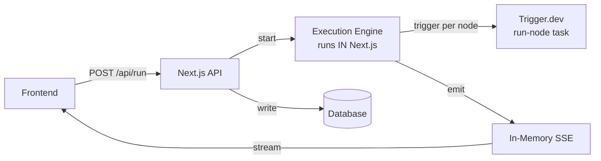
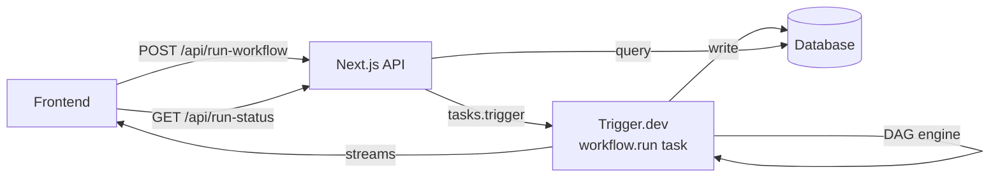
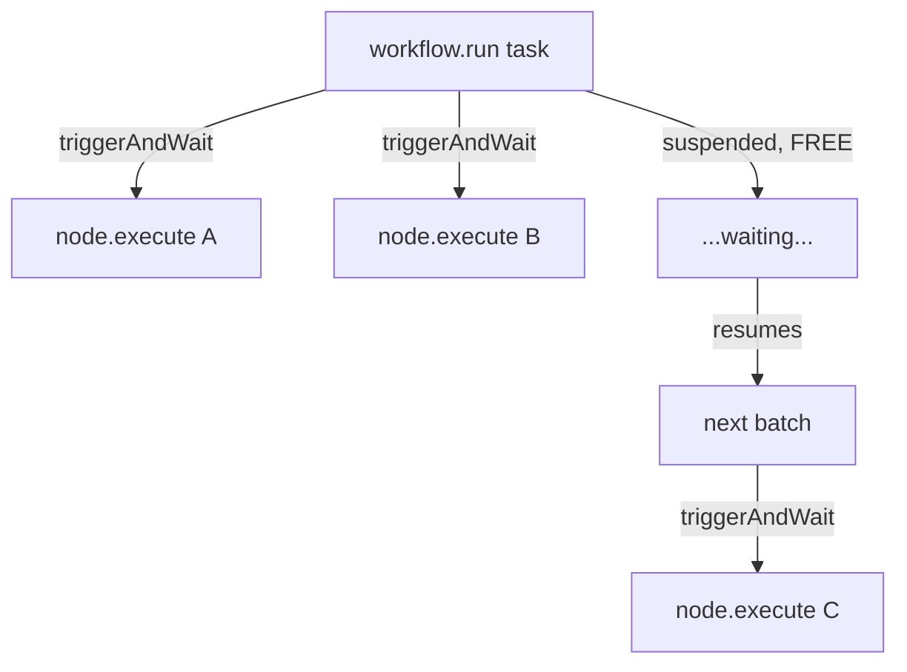
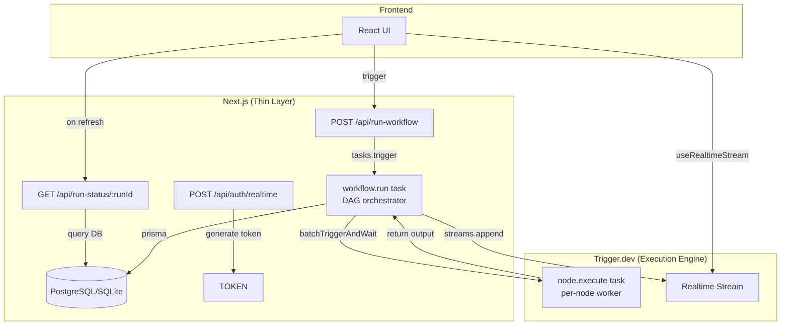

# FlowForge Backend Architecture Analysis

## What Changed (v1 → v2)

### v1 — "Next.js Does Everything"


**Problems:**
- Execution engine lives inside Next.js (serverless = dies between requests)
- Custom SSE system with in-memory `clients` map (breaks in serverless — POST and GET can be different instances)
- Next.js orchestrates the DAG — wasteful, fragile
- Trigger.dev only runs individual nodes (pointless overhead per node)

---

### v2 — "Trigger.dev Owns Execution" (Your New Design)


**What's better:**
- ✅ **Trigger.dev owns the entire workflow** — no serverless timeout risk
- ✅ **No custom SSE** — Trigger.dev Streams handle real-time updates natively
- ✅ **Next.js becomes thin** — just 2 API routes (trigger + status query)
- ✅ **DB is source of truth** — page refresh recovers state from DB

---

## 🔴 Critical Issues Found

### 1. `io.send()` does NOT exist in Trigger.dev v4

Your code uses:
```ts
// ❌ This is Trigger.dev v2 API — doesn't exist in v4
await io.send("node_start", { nodeId })
```

**The correct v4 API is `streams`:**
```ts
// ✅ Correct — using Trigger.dev v4 Streams API
import { streams } from "@trigger.dev/sdk"

// Define a typed stream (shared file)
export const workflowEvents = streams.define<WorkflowEvent>({
  id: "workflow-events"
})

// Inside task — append events
await workflowEvents.append({ type: "node_start", nodeId })
```

### 2. `io` parameter doesn't exist — it's `ctx`

```ts
// ❌ Wrong
run: async (payload, { io }) => { ... }

// ✅ Correct
run: async (payload, { ctx }) => { ... }
```

### 3. The stream proxy approach is wrong

Your proxy:
```ts
// ❌ This endpoint doesn't exist
const res = await fetch(`https://api.trigger.dev/v3/runs/${runId}/stream`)
```

**Correct approach — use `@trigger.dev/react-hooks`:**
```tsx
// ✅ Frontend subscribes directly via React hook
import { useRealtimeStream } from "@trigger.dev/react-hooks"
import { workflowEvents } from "@/src/trigger/streams"

const { parts } = useRealtimeStream(workflowEvents, runId, {
  accessToken: publicAccessToken
})
```

> This completely eliminates the proxy API route. Trigger.dev handles the connection directly from the frontend.

### 4. DB writes are missing from the task code

Your task code emits events but never calls `startNode()`, `completeNode()`, `failNode()`. The DB layer was in v1 but got dropped from v2.

### 5. No error handling inside `Promise.all`

```ts
// ❌ If ANY node throws, the entire batch fails
const results = await Promise.all(
  batch.map(async (nodeId) => {
    await io.send("node_start", { nodeId })
    const result = await runNode(nodeId, outputs) // 💥 throws = batch dead
  })
)
```

---

## 🟡 Cost & Money Concerns

### The Single-Task Problem

Running the **entire workflow** as one Trigger.dev task means:

| Scenario | Compute Billed |
|---|---|
| 5 nodes × 2s each (serial) | ~10 seconds |
| 5 nodes × 30s each (serial) | ~2.5 minutes |
| 10 nodes with LLM calls | **5-15 minutes** |

You're billed for every second the task is alive — including time spent waiting for parallel nodes.

### The Solution: Child Tasks + `triggerAndWait`

> [!IMPORTANT]
> `triggerAndWait()` **suspends** the parent task (via CRIU checkpointing). The parent is **NOT billed** while waiting. You only pay for actual compute.



But there's a caveat from the docs:

> [!WARNING]
> **"Don't use `triggerAndWait` in parallel, e.g. with `Promise.all()`"**
> 
> Use `batchTriggerAndWait()` instead for parallel execution of the same task type.

So for parallel node batches:
```ts
// ✅ Correct way to run batch of nodes in parallel
const results = await executeNodeTask.batchTriggerAndWait(
  batch.map(nodeId => ({
    payload: { nodeId, inputs: gatherInputs(nodeId, outputs) }
  }))
)
```

### Cost Comparison

| Approach | 10 nodes × 5s each | Cost |
|---|---|---|
| Single task (everything inline) | 50s billed | 💰💰 |
| Child tasks + `batchTriggerAndWait` | 50s node compute + ~2s orchestrator | 💰 (same compute, but orchestrator is FREE while waiting) |

The savings compound with longer-running nodes (LLM calls, API calls, etc.)

---

## 🟢 Improved Architecture (Recommended)



### File Structure
```
app/
  api/
    run-workflow/route.ts        ← POST: trigger workflow task
    run-status/[runId]/route.ts  ← GET:  query DB for refresh
    auth/realtime/route.ts       ← POST: generate public access token

lib/
  prisma.ts                      ← Prisma client singleton
  db/
    run.repository.ts            ← createRun, completeRun, failRun
    node.repository.ts           ← startNode, completeNode, failNode, getNodeExecutions

src/trigger/
  streams.ts                     ← streams.define<WorkflowEvent>()
  workflow.task.ts               ← DAG orchestrator task
  node.task.ts                   ← Per-node execution task
  engine/
    dag.ts                       ← buildDAG (pure function)
    types.ts                     ← Graph, Node, Edge, WorkflowEvent types

prisma/
  schema.prisma                  ← Run + NodeExecution models
```

### Key Design Decisions

| Decision | Why |
|---|---|
| **`batchTriggerAndWait`** for parallel nodes | Parent suspends = free, docs say don't use `Promise.all` with `triggerAndWait` |
| **`streams.define()`** for events | Type-safe, works with React hooks, no custom SSE needed |
| **DB writes inside orchestrator task** | Task has durable execution — if it crashes, Trigger.dev retries it |
| **Separate `node.task.ts`** | Each node is isolated — can have its own retries, timeouts, error handling |
| **`/api/auth/realtime`** route | Generates public access tokens so frontend can subscribe to streams |
| **`/api/run-status/:runId`** for refresh** | Queries DB directly — no dependency on active stream |

---

## Summary: What's Good vs What Needs Fixing

### ✅ Your v2 ideas that are correct:
1. Moving execution into Trigger.dev ← **great decision**
2. Using DB for refresh resilience ← **exactly right**
3. In-memory `outputs` only for passing data between nodes ← **correct**
4. DAG builder as pure function ← **keep it**

### ❌ Things that need fixing:
1. `io.send()` → use `streams.define()` + `streams.append()`
2. `{ io }` → `{ ctx }`
3. Stream proxy route → use `@trigger.dev/react-hooks` directly
4. Add DB writes back into the task
5. Use `batchTriggerAndWait` instead of `Promise.all` with inline work
6. Add proper error handling per node
7. Add TypeScript types (no `any`)
