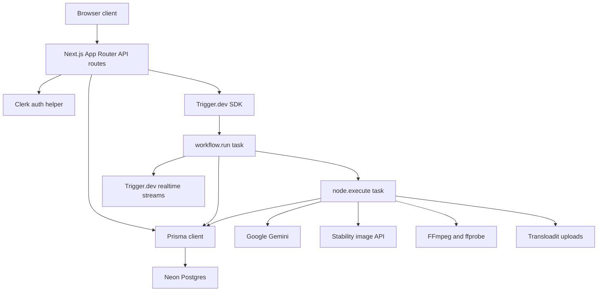
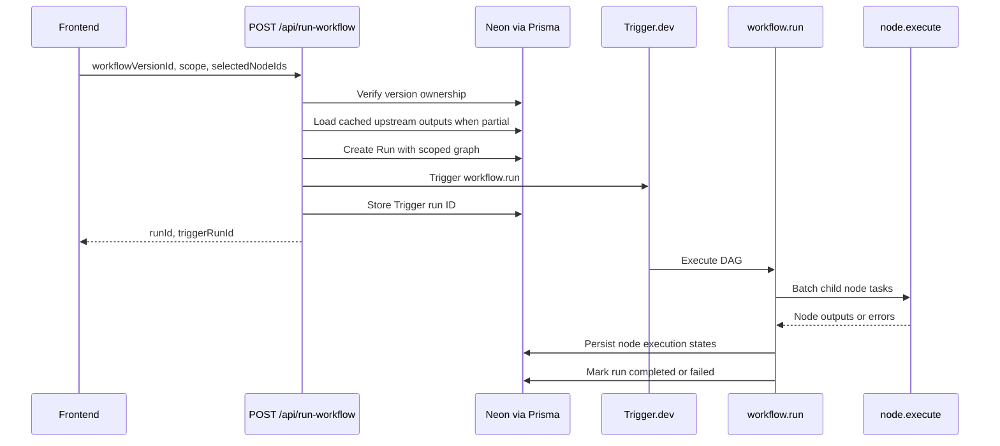
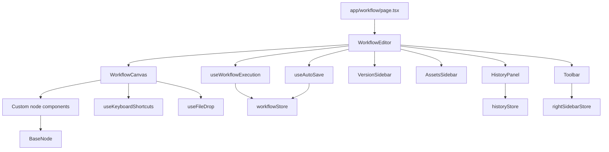
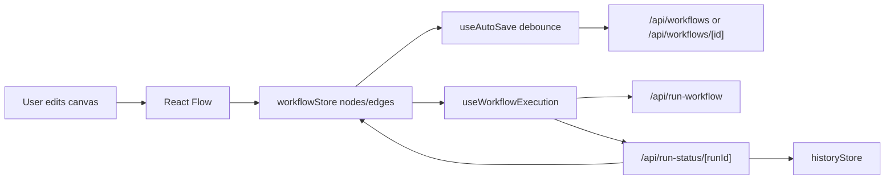
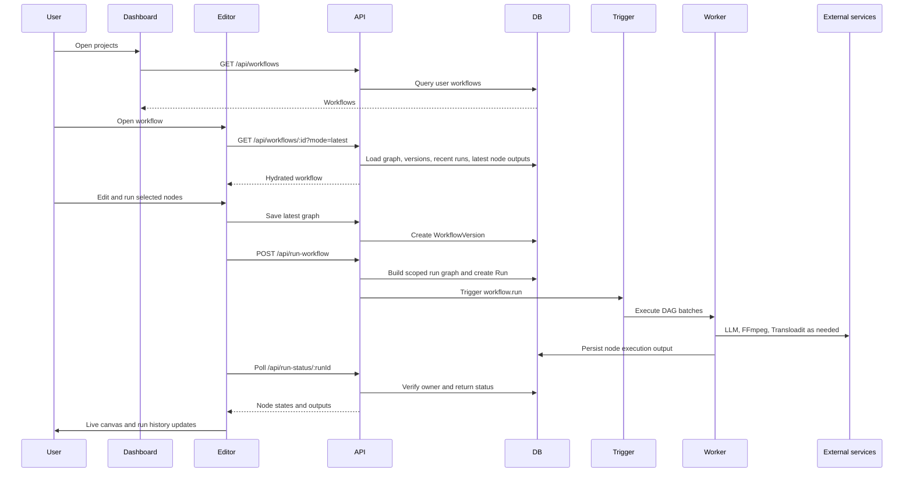

# FlowForge Architecture Workflows

This document describes the application as three end-to-end workflows:

1. Full backend architecture
2. Full frontend architecture
3. End-to-end execution architecture

It also lists the production configuration required for Vercel and Trigger.dev.

---

## 1. Full Backend Architecture

### Backend System Map

### Backend Responsibilities

| Layer | Files | Responsibility | Production note |
|---|---|---|---|
| Route handlers | `app/api/**/route.ts` | Auth, validation, persistence, run status, uploads, realtime tokens | Runs on Vercel serverless functions |
| Auth helper | `lib/auth.ts` | Clerk when configured, anonymous local fallback when not configured | Clerk env vars should be set in prod |
| Persistence | `lib/prisma.ts`, `prisma/schema.prisma` | Neon-backed workflow, version, run, and node execution records | Requires `DATABASE_URL` |
| Trigger orchestration | `src/trigger/workflow.task.ts` | DAG traversal, batching, run completion/failure | Deployed with Trigger.dev |
| Node execution | `src/trigger/node.task.ts` | Text, upload, LLM, crop image, extract frame nodes | Requires external API/upload env vars |
| Realtime | `src/trigger/streams.ts`, `app/api/auth/realtime/route.ts` | Scoped public token and workflow events | Token route verifies run ownership |

### Core Data Model

| Entity | Purpose | Key relations |
|---|---|---|
| `User` | Clerk user or local anonymous user | Has many workflows |
| `Workflow` | User-owned project | Has many versions |
| `WorkflowVersion` | Immutable saved graph snapshot | Has many runs |
| `Run` | One execution attempt | Belongs to a version and user |
| `NodeExecution` | Per-node status/output/error | Unique by run plus node ID |

### Run API Flow

### Selected Run Behavior

| Scenario | Backend behavior |
|---|---|
| Full run | Triggers the saved full graph |
| Single selected node | Builds a graph containing the selected node plus cached ancestors |
| Multiple selected nodes | Builds a graph containing selected nodes plus cached ancestors |
| Missing ancestor output | Returns `400` before starting Trigger.dev |
| Cached ancestor | Used only as an input value and skipped by the task runner |

### Backend Error Handling

| Error | Handling |
|---|---|
| Unauthenticated request | `401 Unauthorized` from shared helper |
| Wrong owner | `403` or `404` depending on endpoint sensitivity |
| Missing cached upstream output | `400` with `missingCachedNodeIds` |
| Node task failure | Node is marked failed and the run is marked failed |
| Missing Transloadit credentials | Node task throws a clear runtime error |

---

## 2. Full Frontend Architecture

### Frontend System Map

### Frontend State Stores

| Store | File | Owns |
|---|---|---|
| Workflow store | `store/workflowStore.ts` | React Flow nodes/edges, execution state, current workflow/version/run IDs |
| History store | `store/historyStore.ts` | Live in-memory run history and selected run |
| Right sidebar store | `store/rightSidebarStore.ts` | Which right-side panel is open |
| Theme store | `store/themeStore.ts` | Dark/light theme |

### Canvas Runtime

### Important UI Flows

| UI flow | Components/hooks | Result |
|---|---|---|
| Load workflow | `useAutoSave` | Loads latest workflow, graph, version ID, and latest node outputs |
| Save workflow | `useAutoSave` | Creates immutable workflow versions after changes |
| Run workflow | `Toolbar`, `useWorkflowExecution` | Saves the latest graph, starts run, polls status |
| View run history | `HistoryPanel` | Loads workflow-scoped runs, then merges live local runs |
| Select prior version | `VersionSidebar` | Replaces canvas graph with selected version |
| Extract frame | `ExtractFrameNode` | Scrub by seconds or enter percent of video duration |

### Frame Extraction UI

| Control | Stored node data | Backend interpretation |
|---|---|---|
| Scrubber | `timestamp`, `timestampMode: "seconds"` | FFmpeg `-ss` uses seconds |
| Percent input | `framePercent`, `timestampMode: "percent"` | Backend uses ffprobe duration and extracts at that percentage |
| Reset | `timestamp: 0`, `framePercent: 0` | Extracts first frame |

---

## 3. End-to-End Architecture

### Full Product Flow

### Execution State Chart

| Step | Frontend state | Backend state | Trigger state |
|---|---|---|---|
| Before run | Nodes are idle or have prior outputs | WorkflowVersion exists | No run |
| Start run | Selected nodes become pending | Run is `PENDING`, then `RUNNING` | `workflow.run` starts |
| Node starts | Node becomes running | NodeExecution is `RUNNING` | Child task executing |
| Node succeeds | Node becomes success with output | NodeExecution is `SUCCESS` | Output passed downstream |
| Node fails | Node becomes failed with error | NodeExecution is `FAILED`, Run becomes `FAILED` | Failed branch stops |
| Workflow completes | Run history marks completed | Run becomes `COMPLETED` | Orchestrator ends |

### Production Configuration

| Variable | Runtime | Required for |
|---|---|---|
| `DATABASE_URL` | Vercel, Prisma CLI | Neon Postgres through Prisma |
| `NEXT_PUBLIC_CLERK_PUBLISHABLE_KEY` | Browser and server | Clerk auth enablement |
| `CLERK_SECRET_KEY` | Vercel server | Clerk server auth |
| `CLERK_WEBHOOK_SECRET` | Vercel server | Clerk webhook verification |
| `TRIGGER_SECRET_KEY` | Vercel server, Trigger CLI | Trigger.dev API access |
| `TRIGGER_PROJECT_ID` | Trigger config | Selecting the production Trigger project |
| `GOOGLE_GENERATIVE_AI_API_KEY` | Trigger worker | Gemini text/image understanding |
| `STABILITY_API_KEY` | Trigger worker | LLM image generation mode |
| `TRANSLOADIT_AUTH_KEY` | Vercel server, Trigger worker | Browser uploads and task uploads |
| `TRANSLOADIT_SECRET` | Vercel server, Trigger worker | Signed Transloadit params and uploads |

### Deployment Checklist

| Target | Command/action | Check |
|---|---|---|
| Vercel | Set env vars and deploy Next.js app | `npm run build` succeeds |
| Database | Run Prisma migrations against Neon | Tables/enums match `prisma/schema.prisma` |
| Trigger.dev | Deploy tasks from `src/trigger` | `workflow.run` and `node.execute` are visible |
| Uploads | Configure Transloadit credentials | Upload nodes return public URLs |
| Auth | Configure Clerk keys and webhook | User-specific workflow data is isolated |

