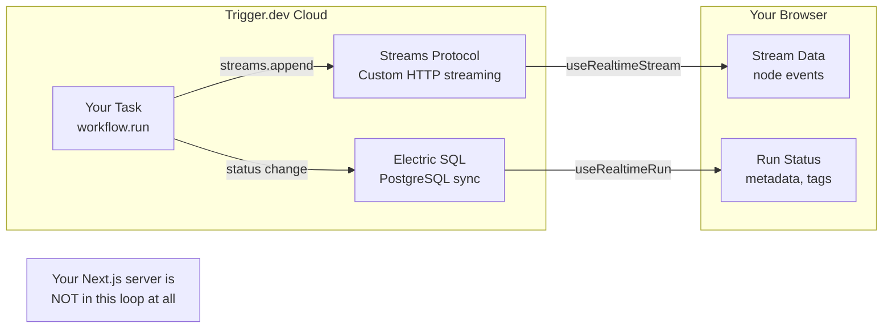

# Frontend Integration Guide (Corrected)

> [!WARNING]
> My previous version incorrectly said "WebSocket". **Trigger.dev uses NEITHER WebSockets NOR SSE.** Here's what it actually uses.

## How Data Actually Gets to the Frontend

Trigger.dev has **two separate transport systems**:

| System | Transport | What it carries | React Hook |
|---|---|---|---|
| **Run Updates** | **Electric SQL** (HTTP-based PostgreSQL sync) | Status changes, metadata, tags | `useRealtimeRun` |
| **Streams** | **Custom streaming protocol** (HTTP-based, auto-reconnect) | Continuous data (`streams.define()`) | `useRealtimeStream` |

**Neither is WebSocket. Neither is SSE.** Both are HTTP-based protocols managed entirely by Trigger.dev's infrastructure.



## The Full Auth + Streaming Flow

### Step 1: Trigger the workflow (Next.js API → Trigger.dev)
```tsx
// Frontend calls your API route
const res = await fetch("/api/run-workflow", {
  method: "POST",
  body: JSON.stringify({ graph }),
});
const { runId, triggerRunId } = await res.json();
```

### Step 2: Get a scoped public token (Next.js API → Frontend)
```tsx
// Frontend asks your server for a limited-access token
const authRes = await fetch("/api/auth/realtime", {
  method: "POST",
  body: JSON.stringify({ triggerRunId }),
});
const { publicAccessToken } = await authRes.json();
```

> [!NOTE]
> After this step, **your Next.js server is done**. All real-time communication
> happens directly between the browser and Trigger.dev Cloud. Your server
> is not a proxy, not an SSE endpoint, nothing.

### Step 3: Subscribe to the stream (Browser → Trigger.dev Cloud directly)

There are **two hooks** you can use depending on your needs:

#### Option A: `useRealtimeStream` — Just stream data (recommended for us)

This is for our `workflowEvents` stream. The correct API signature from the docs:

```tsx
"use client";
import { useRealtimeStream } from "@trigger.dev/react-hooks";
import { workflowEvents } from "@/src/trigger/streams";

export function WorkflowStreamViewer({
  runId,
  publicAccessToken,
}: {
  runId: string;
  publicAccessToken: string;
}) {
  // Pass the defined stream object for full type safety
  const { parts, error } = useRealtimeStream(workflowEvents, runId, {
    accessToken: publicAccessToken,
    timeoutInSeconds: 600, // 10 min timeout for long workflows
    onData: (event) => {
      // event is typed as WorkflowEvent (our discriminated union)
      console.log("New event:", event);
    },
  });

  if (error) return <div>Error: {error.message}</div>;
  if (!parts) return <div>Waiting for stream...</div>;

  return (
    <div>
      {parts.map((event, i) => (
        <div key={i}>
          {event.type === "node_start"    && `🚀 Node ${event.nodeId} running...`}
          {event.type === "node_complete" && `✅ Node ${event.nodeId} done`}
          {event.type === "node_failed"   && `❌ Node ${event.nodeId}: ${event.error}`}
          {event.type === "workflow_done" && `🎉 Workflow complete!`}
        </div>
      ))}
    </div>
  );
}
```

#### Option B: `useRealtimeRunWithStreams` — Run status + streams together

Use this if you also want to track the overall run status (RUNNING, COMPLETED, etc.):

```tsx
"use client";
import { useRealtimeRunWithStreams } from "@trigger.dev/react-hooks";
import type { workflowTask } from "@/src/trigger/workflow.task";
import type { WorkflowEvent } from "@/src/trigger/engine/types";

type STREAMS = {
  "workflow-events": WorkflowEvent;
};

export function WorkflowRunViewer({
  runId,
  publicAccessToken,
}: {
  runId: string;
  publicAccessToken: string;
}) {
  const { run, streams, error } = useRealtimeRunWithStreams<
    typeof workflowTask,
    STREAMS
  >(runId, {
    accessToken: publicAccessToken,
  });

  if (error) return <div>Error: {error.message}</div>;
  if (!run) return <div>Loading...</div>;

  const events = streams["workflow-events"] ?? [];

  return (
    <div>
      <p>Run Status: {run.status}</p>
      {events.map((event, i) => (
        <div key={i}>
          {event.type === "node_start" && `🚀 ${event.nodeId}`}
          {event.type === "node_complete" && `✅ ${event.nodeId}`}
        </div>
      ))}
    </div>
  );
}
```

## Which Hook Should We Use?

For FlowForge, I recommend **`useRealtimeRunWithStreams`** (Option B) because:

1. We need the **stream events** (node_start, node_complete) to animate the ReactFlow graph
2. We also need the **run status** to know when the overall workflow finishes or fails
3. It gives us both in a single hook call

## Why This is Better Than Our Old SSE System

| Old SSE System | Trigger.dev Realtime |
|---|---|
| Next.js server holds open connections | Your server does nothing |
| In-memory `clients` map (breaks in serverless) | Trigger.dev Cloud handles all connections |
| Custom reconnect logic needed | Auto-reconnect built in |
| Events lost on server restart | Stream retention for 28 days |
| One server = limited connections | Handles 20,000+ updates/sec |

## Security Summary

1. **`TRIGGER_SECRET_KEY`** → Never leaves your server. Used only in API routes.
2. **`publicAccessToken`** → Short-lived (1 hour), scoped to ONE run ID. Safe to send to browser.
3. **No master key exposure** → Even if token is stolen, attacker can only read events from that single run.
