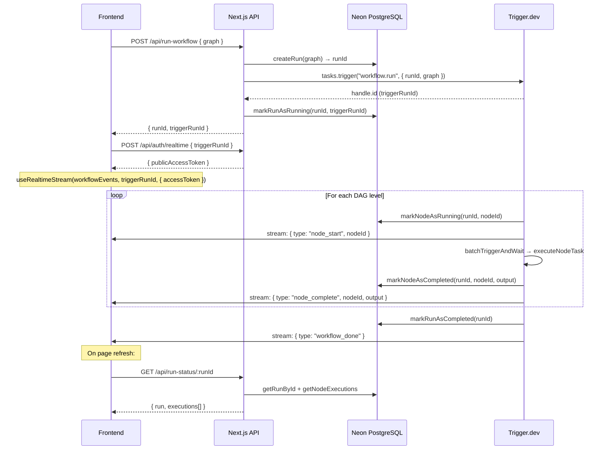

# FlowForge Backend — Implementation Summary

## ✅ All checks pass
- **TypeScript**: Zero errors
- **Prisma**: Schema pushed to Neon PostgreSQL
- **Dependencies installed**: `@prisma/client`, `@prisma/adapter-neon`, `@neondatabase/serverless`, `@trigger.dev/react-hooks`, `dotenv`

## File Map

### Database Layer
| File | Purpose |
|---|---|
| [schema.prisma](prisma/schema.prisma) | `Run` + `NodeExecution` models with enums |
| [prisma.ts](lib/prisma.ts) | Singleton client with Neon adapter (Prisma v7) |
| [run.repository.ts](lib/db/run.repository.ts) | `createRun`, `markRunAsRunning`, `markRunAsCompleted`, `markRunAsFailed`, `getRunById` |
| [node.repository.ts](lib/db/node.repository.ts) | `markNodeAsRunning`, `markNodeAsCompleted`, `markNodeAsFailed`, `getNodeExecutions` |

### Trigger.dev Engine
| File | Purpose |
|---|---|
| [types.ts](src/trigger/engine/types.ts) | `Graph`, `GraphNode`, `GraphEdge`, `DAG`, `WorkflowEvent` (discriminated union), `NodeExecutionPayload` |
| [dag.ts](src/trigger/engine/dag.ts) | `buildDAG()`, `findRootNodes()` — pure functions |
| [streams.ts](src/trigger/streams.ts) | `workflowEvents` stream definition via `streams.define<WorkflowEvent>()` |
| [node.task.ts](src/trigger/node.task.ts) | `executeNodeTask` — child task, runs a single node |
| [workflow.task.ts](src/trigger/workflow.task.ts) | `workflowTask` — orchestrator, runs DAG via `batchTriggerAndWait` |

### API Routes
| Route | Method | Purpose |
|---|---|---|
| [/api/run-workflow](app/api/run-workflow/route.ts) | POST | Trigger a workflow, returns `{ runId, triggerRunId }` |
| [/api/run-status/[runId]](app/api/run-status/[runId]/route.ts) | GET | Query DB for refresh resilience |
| [/api/auth/realtime](app/api/auth/realtime/route.ts) | POST | Generate scoped public access token for frontend stream |

## Data Flow



## Next Steps

1. **Add your env vars** to `.env` (DATABASE_URL is already set, add your TRIGGER_SECRET_KEY)
2. **Run `npx trigger.dev@latest dev`** to register the tasks
3. **Build the frontend** — use `@trigger.dev/react-hooks`:
   ```tsx
   import { useRealtimeStream } from "@trigger.dev/react-hooks"
   import { workflowEvents } from "@/src/trigger/streams"

   const { parts } = useRealtimeStream(workflowEvents, triggerRunId, {
     accessToken: publicAccessToken,
   })
   ```
4. **Customize `node.task.ts`** — replace the placeholder with real node logic (LLM calls, API calls, etc.)
